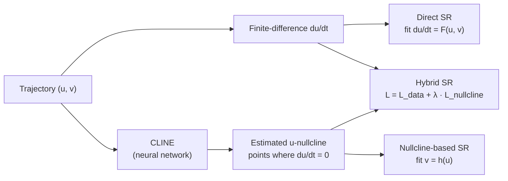
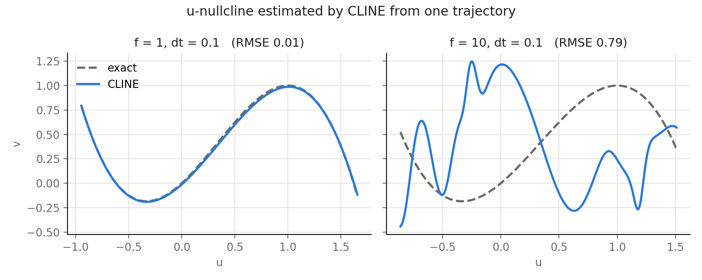
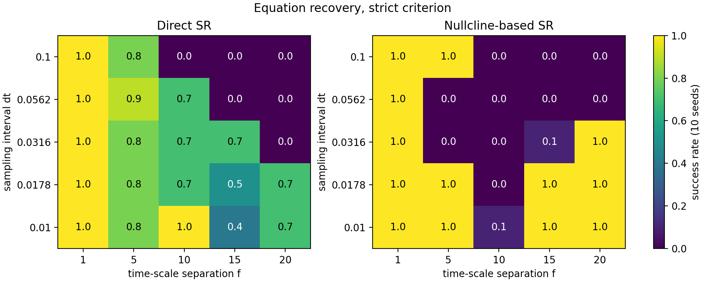
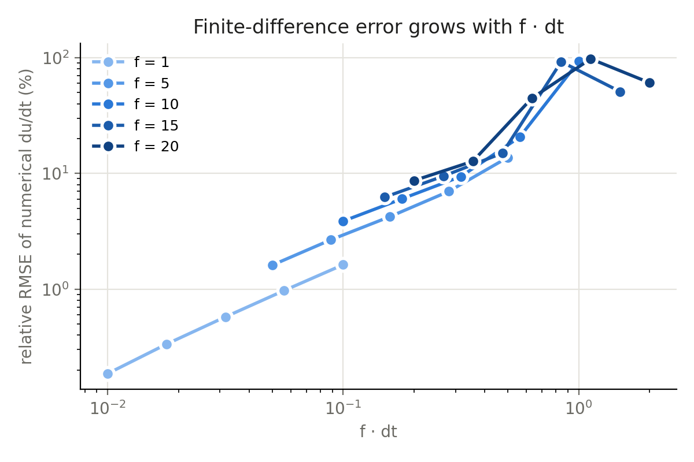
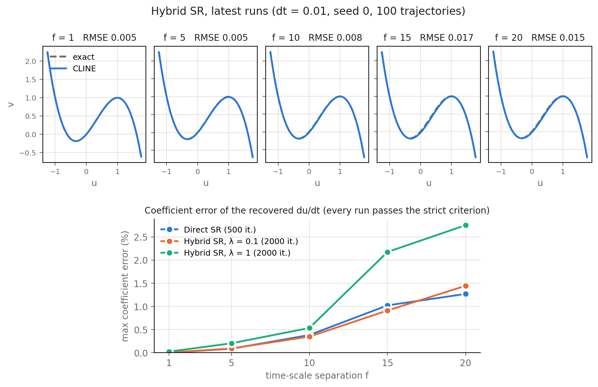

# Nullcline-guided symbolic regression for fast–slow systems

Can we recover the governing equations of a dynamical system from time-series
data alone when its variables evolve on very different time scales? This
project studies that question on the FitzHugh–Nagumo (FHN) model and asks
whether **nullclines estimated from data** can make symbolic regression more
reliable.

*Undergraduate research project, June – October 2026.*

```
du/dt = f · (−u³ + u² + u − v)        fast variable, time-scale separation f
dv/dt = 0.3 · (u − 0.5 v)              slow variable
```

## Approach

Three ways of recovering `du/dt`, all using [PySR](https://github.com/MilesCranmer/PySR)
with the same operator set (`+ − ×`, max size 20):



* **Direct SR** regresses the numerical derivative on the state.
* **Nullcline-based SR** first estimates the u-nullcline with
  [CLINE](https://arxiv.org/abs/2503.16240) and then recovers its equation.
  This avoids using the noisy derivative as a regression target.
* **Hybrid SR** (custom Julia loss) fits the trajectory while requiring the
  equation to vanish on the estimated nullcline. The nullcline acts as a
  geometric constraint on the search space.

A run counts as a success if any equation on PySR's Pareto front has exactly
the target terms and every coefficient within ±15 % of its true value
(**strict**). The **relaxed** criterion only requires the correct terms.
See [`src/nullsr/evaluate.py`](src/nullsr/evaluate.py).

## Findings

### 1. CLINE recovers the nullcline when the fast dynamics are well sampled



With one trajectory, CLINE matches the exact nullcline at f = 1 (RMSE 0.01) but
fails when the fast dynamics are under-sampled (f = 10, dt = 0.1). With 100
trajectories and dt = 0.01, the RMSE stays at or below 0.017 for every f
(Finding 4).

### 2. Strong time-scale separation breaks both methods



Sweep: f ∈ {1, 5, 10, 15, 20} × 5 sampling intervals dt × 10 PySR seeds
(250 runs per method, one trajectory of 10,000 points).

| | Direct SR | Nullcline-based SR |
|---|---|---|
| Strict (correct terms and coefficients) | 152 / 250 | 132 / 250 |
| Relaxed (correct terms only) | 161 / 250 | 220 / 250 |

Both methods degrade as f grows and dt is coarse. Nullcline-based SR finds the
correct **structure** much more often (220 vs. 161). However, its coefficients
inherit the error of the estimated nullcline, so it is not more accurate under
the strict criterion. [Relaxed heatmap](figures/timescale_success_relaxed.png).
Direct SR also tends to converge to the *same* wrong equation across seeds,
which points to a systematic bias rather than search noise.

### 3. The main cause is finite-difference error, not the time-scale separation itself



The relative error of the numerical derivative is controlled by `f · dt` and
reaches ~100 % near `f · dt ≈ 1`. When the exact derivative replaces the
numerical one (control run, dt = 0.1, seed 0), Direct SR recovers the equation
for **all five f** (5/5 strict), including f = 10–20 where it otherwise fails in
all 10 seeds. Nullcline-based SR with CLINE trained on the exact derivative
recovers the structure in 5/5 cases (4/5 strict). Caveat: the control
trajectories were simulated with the accurate integrator (see Limitations), so
this control changes two things at once. A matched rerun is planned.

### 4. Hybrid SR with an accurate nullcline: works, but not yet better than Direct SR



With 100 trajectories and dt = 0.01, Hybrid SR recovers the equation for every
f and both λ (10/10 strict, max coefficient error ≤ 2.7 %). In this regime,
Direct SR also succeeds for every f, so the data do not yet show an advantage
for the nullcline constraint. A control run with the *exact* nullcline (500
iterations) passed 6/10, which shows that nullcline accuracy is not the only
factor. Search budget matters as well.

## Limitations

* **Unequal search budgets.** The latest Hybrid runs used 2000 PySR iterations,
  while Direct SR used 500. An equal-budget comparison is still missing.
* **Few seeds for Hybrid SR.** One seed per setting. The sweep used 10.
* **Integrator in the sweep.** The sweep data were simulated with plain RK4
  (one step per dt). For `f · dt > 0.8`, this under-estimates the limit-cycle
  amplitude by 8–9 %, so failures there partly reflect simulation error.
  The default generator now uses 10 RK4 sub-steps. `--legacy` reproduces the
  archived data.
* Noise-free synthetic data from one model. Success is judged on the training
  data's Pareto front, not on held-out trajectories.

## Next steps

* Compare Direct and Hybrid SR at equal budgets, with 10 seeds, in harder regimes
  (coarse dt, few trajectories, measurement noise), where Findings 2–3 predict
  that the nullcline constraint should help.
* Test a second fast–slow model with a different nullcline geometry (bicubic
  oscillator).
* Longer term: implicit symbolic regression of the nullcline itself, and using
  causal discovery (GOBI) to pre-select the variables in each equation.

## Repository layout

```
src/nullsr/          FHN simulator, CLINE wrapper, PySR settings, success criteria
experiments/
  01_cline_reproduction/   CLINE accuracy vs. trajectory length
  02_timescale_sweep/      f × dt × seed sweep, true-derivative controls, figures
  03_hybrid_sr/            Direct vs. Hybrid vs. exact-nullcline Hybrid
results/             re-scored summaries of every archived run (see results/README.md)
figures/             figures in this README
```

## Reproducing

```bash
python -m venv .venv && source .venv/bin/activate
pip install -r requirements.txt && pip install -e .   # PySR installs Julia on first run

cd experiments/02_timescale_sweep
python 01_generate_data.py --legacy     # data used for the archived results
python 02_direct_sr.py                  # 250 PySR runs (hours on a laptop)
python 03_cline_nullcline.py && python 04_nullcline_sr.py
python 05_evaluate.py && python 06_plot.py && python 07_plot_diagnostics.py
```

The figures can be redrawn without rerunning anything, from the tables in
`results/`: `06_plot.py`, `07_plot_diagnostics.py`, `03_hybrid_sr/05_plot.py`.

## Acknowledgements

* CLINE / pyCLINE: B. Prokop, J. Billen, N. Frolov, L. Gelens,
  *Machine learning-based inference of nullclines of oscillatory systems*
  (2025), [arXiv:2503.16240](https://arxiv.org/abs/2503.16240), MIT License.
  The FHN generator in `src/nullsr/fhn.py` extends theirs.
* PySR: M. Cranmer, *Interpretable machine learning for science with PySR and
  SymbolicRegression.jl* (2023), [arXiv:2305.01582](https://arxiv.org/abs/2305.01582).
